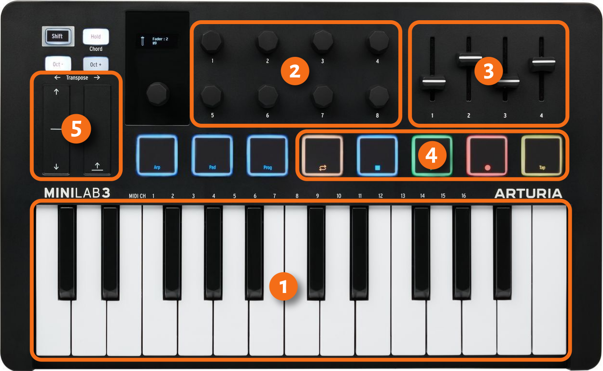
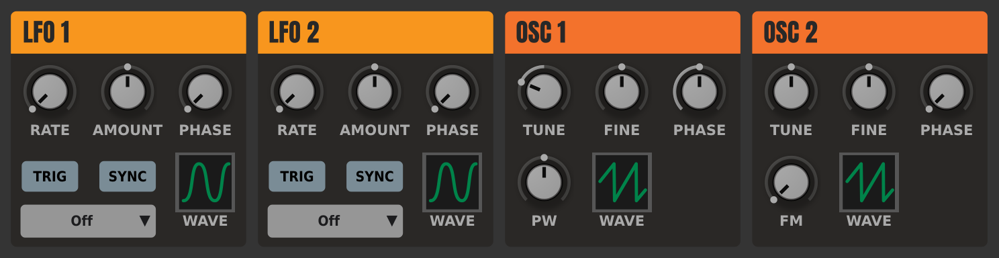
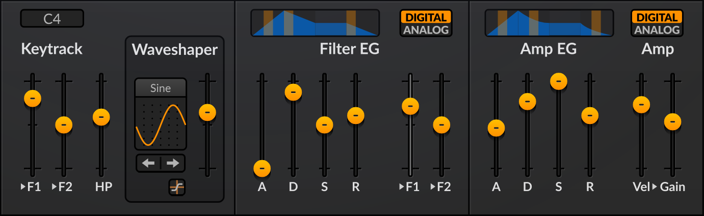
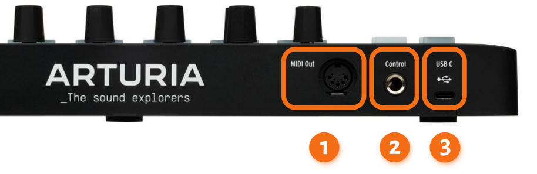

四十多年来，MIDI 一直是歌曲创作和音乐制作领域至关重要的技术。然而，新用户仍然难以理解它的工作原理。本章简要概述了高效使用 Ardour 所必须了解的 MIDI 基础知识。

如果先不进行一些练习，本章可能会显得有些让人不知所措，所以当你准备录制 MIDI 时，请随时回来再读一遍。

## 什么是 MIDI？

MIDI（Musical Instrument Digital Interface，乐器数字接口）是一种通信协议，允许电子乐器、计算机和其他设备交换信息。它发送的不是音频，而是消息或指令。

## 你会在哪里遇到 MIDI

MIDI 在音乐制作中几乎无处不在。

像 Launchpad 这样的 MIDI 键盘和网格控制器，通常会向硬件合成器和数字音频工作站发送 MIDI 消息。

将桌面编辑器中的音色包上传到吉他多重效果处理器，通常涉及发送 SysEx MIDI 消息。

## MIDI 如何工作

最重要的一点是，MIDI 键盘本身**不会发出任何声音**。它们所做的是发送指令，硬件或软件可以解释这些指令来发声、改变声音或完全做其他事情。

大多数时候，你处理 MIDI 的方式是录制自己在 MIDI 键盘上的演奏。

这台典型的 MIDI 键盘配备了最少的控制元件：

1. **琴键**。每次你按下白键或黑键时，键盘都会发送一个 `NOTE ON` 命令，并说明应该开始播放哪个音符。每次你松开按键时，键盘都会发送一个 `NOTE OFF` 命令，并说明关于该音符和通道的相同信息。

2. **编码器**。这些通常是旋转按钮，用于控制硬件和软件合成器的各种参数。大多数时候，你会用它们来控制软件合成器的控件，就像这些：

编码器可能具有物理上的最小和最大限制。旋转至最大值或最小值后，就无法再继续旋转；这类编码器通常被称为绝对编码器（absolute encoders）。但近年来，没有这种物理限制的无尽编码器（Endless Encoders）已经成为常态。

当你顺时针或逆时针旋转编码器时，MIDI 键盘会发送一种不同类型的消息，称为 `Control Change`（控制变更），或 `CC`。CC 消息带有标识它们的编号，例如 `CC21`。它们还包含编码器发送的新值。

3. **推子**。与编码器不同，推子始终具有最小和最大值的物理限制。它们通常用于控制数字音频工作站中的混音器，或合成器和采样器中的 ADSR 等控件：

就像编码器一样，推子发送 CC 消息。

4. **走带控制**。这些按钮用于切换数字音频工作站中的播放和录音，并执行各种其他操作，如快进、返回开头或切换循环播放模式。为此，它们也会发送 CC 消息。

5. **弯音**和**调制**控件。

## MIDI 消息如何发送

让我们看看同一款键盘的背板：

你在这里看到的内容取决于供应商和型号，但总体思路是，MIDI 键盘可以通过 MIDI OUT（**1**）和 USB（**3**）端口发送消息。

MIDI OUT 端口通常用于将键盘直接连接到硬件合成器或采样器。如果你的音频接口有 MIDI IN 端口，你也可以将它连接到音频接口的 MIDI IN 端口。

USB 端口通常用于将键盘直接连接到计算机。

上方面板上的 Control（控制）端口（**2**）通常用于连接延音（`CC64`）或表情（`CC11`）脚踏板。来自延音踏板和表情踏板的消息，会通过 MIDI OUT 或 USB 端口传输到数字音频工作站。

## Ardour 如何播放 MIDI

如果 MIDI 键盘不发出声音，那谁来发声呢？

除非你另有指定，否则 Ardour 在创建每个新的 MIDI 轨道时，都会自动添加一个虚拟合成器。这意味着你总能听到 MIDI 轨道处理来自输入端（如你的 MIDI 键盘）或 MIDI 轨道本身的指令并播放声音。

## 什么是 MIDI 通道？

你需要在这里学习的最后一个概念是 MIDI 通道。考虑这个设置：你将一台 MIDI 键盘连接到一台硬件合成器。合成器可以存储预设或音色，每个预设产生独特的声音。作为一台复音合成器，它可以同时播放不同的声音，例如同时播放低音和主音部分。为此，它期望每个音色的指令通过称为 MIDI 通道的独立路径分别传入。

## 延伸阅读

如果你想了解如何将 MIDI 设备与 Ardour 高效配合使用，请阅读 [MIDI 设备](/using-your-gear/midi-devices) 章节。

**继续**

在下一章中，我们将在 Ubuntu Linux 上启动 Ardour，并学习用户界面的基础知识。