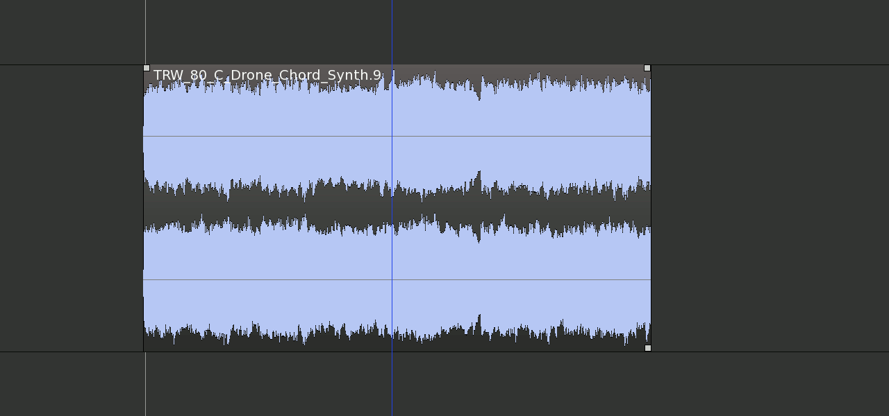
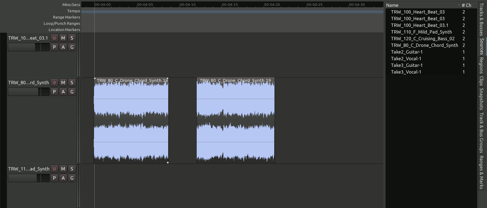
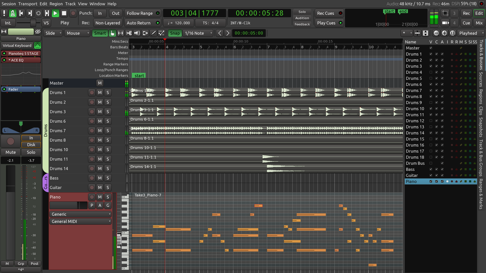

在前面的某个章节中，我们已经讨论过，Ardour 是在一个包含你所有素材的“会话”上运作的：音频剪辑、MIDI 剪辑、应用于轨道和总线的所有效果等等。在我们进行实际编辑之前，先来聊聊非破坏性编辑的基础知识、它在 Ardour 中是如何实现的，以及为什么当你进行大量编辑时，它应该能让你感到安心。

## 非破坏性编辑到底是什么意思？

简单地说，非破坏性编辑方法意味着：无论你做什么，你的源素材始终保持原样。程序不会去改写原始文件，而是描述你所做的更改，将它们存储在项目文件中，然后在加载该项目时“重放”这些更改。

## 它在 Ardour 中是如何工作的？

这里有一个简单的例子。让我们录制一段短音频，把它剪成两半，然后把右半部分向右拖动，制造一个空隙：

这里实际发生的事情是这样的：Ardour 创建了一个引用原始音频文件的片段，并使用了它的所有数据，从第一个采样到最后一个采样。

当你把文件一分为二时，Ardour 会创建两个片段，它们都引用同一个原始文件。但现在项目文件记录的是：左侧片段从时间线上的这个点开始，以原始文件的第一个采样开头，并在中间的那个采样处停止；而第二个片段在时间线上的另一个点开始，以原始文件中间的那个采样开头，然后在原始文件的最后一个采样处停止。

你可以把音频片段剪切成任意多个更小的片段，在轨道之间移动它们，更改它们的开始/结束点，拉伸或收缩它们等等。原始音频文件在磁盘上永远不会改变。

当你保存项目时，所有这些信息都会保存在会话文件中。当你重新打开会话时，Ardour 会读取所有这些引用，加载原始文件，并从原始音频文件重建所有编辑过的音频片段。这就是“重放更改”的真正含义。

如果你不喜欢你对某个录音条目的编辑方式，而且你在编辑上已经走得太远，无法撤销这些更改，你可以不用重新录制，直接从头开始。为此，你可以按 **Shift+L** 打开右侧边栏，转到 _源文件_ 选项卡，抓取该录音条目的原始音频文件名，将其拖放到任意轨道上，然后随意移动、剪切等。

此外，你应用到轨道上的任何效果也都是非破坏性的。Ardour 会将它们应用于原始音频流，并实时播放结果。

对于通过合成器播放的 MIDI 片段，Ardour 会使用合成器在播放头滚动时渲染音频数据流，捕获该音频流，对其应用效果，然后随着播放实时输出最终的音频流。

## 音频片段与 MIDI 片段的区别

如你所知，音频文件始终保持原样。但 MIDI 片段不同：你实际上可以编辑它们的内容，并且更改会保存到磁盘上的 MIDI 文件中。

一个需要特别注意的区别是当你想要将多个片段合并为一个时。对于音频片段，你可以通过选中要合并的片段，然后使用 `区域 > 编辑 > 组合` 来实现。这会创建一种“元片段”，它引用了磁盘上的 N 个音频文件。

然而，你不能对 MIDI 片段做同样的事，主要是因为它们在磁盘上是可以被编辑的，因此合并一些物理上会发生变化的内容，可能会对数据连续性造成严重破坏。

## Ardour 将源素材存储在哪里？

看一下这个通用项目。你在这里有若干代表鼓组的音频轨道、两条分别代表贝斯和主音吉他的音频轨道，以及一条代表电钢琴的 MIDI 轨道。

如果你进入会话文件夹，你会看到许多子文件夹，其中包括这两个：

- `interchange`，这是存储源音频和 MIDI 文件的地方；
- `plugins`，Ardour 在此保存项目中每个插件实例的状态。

当你录制一种乐器时，你录制的每一遍都会以每个通道对应一个物理音频文件的形式来呈现。所以，如果你在一个立体声轨道上录了三遍，你就会得到 6 个音频文件。

## Ardour 会更改磁盘上的音频数据吗？

Ardour 只有在明确告诉你移除项目中未使用的音频文件时，才会对磁盘上的实际音频文件执行操作。通常，当你录了几十遍，做出了选择，并且因为空间原因不再希望这些文件留在磁盘上时，才会这样做。

即便如此，你也是分两步来完成的。首先，进入 `会话 > 清理 > 清理未使用的源文件`，将未使用的原始文件放入回收站；然后，单独进入 `会话 > 清空 > 清空回收站`，实际告诉 Ardour 物理删除这些未使用的文件。

**继续**

现在你已经熟悉了非破坏性编辑的基础知识，让我们来做一些实际的编排和编辑吧。