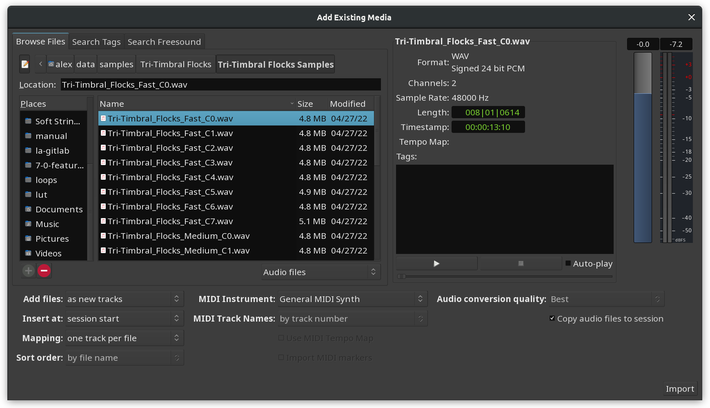
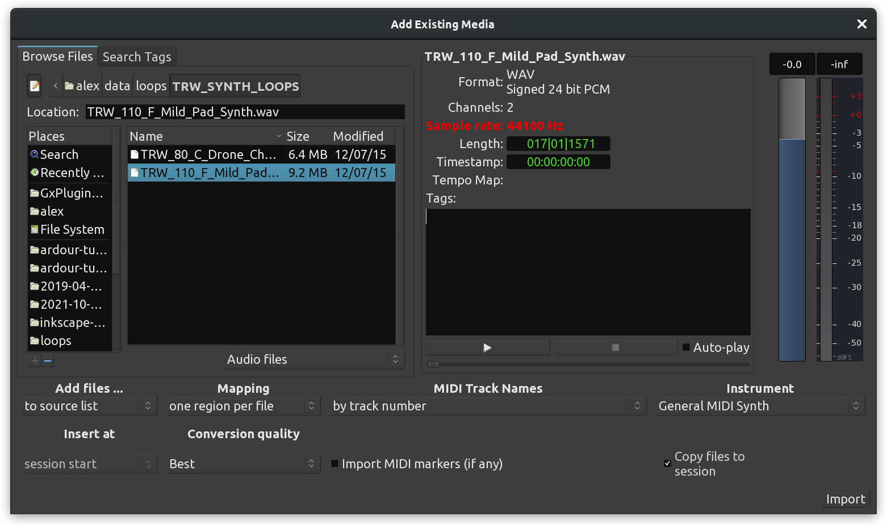
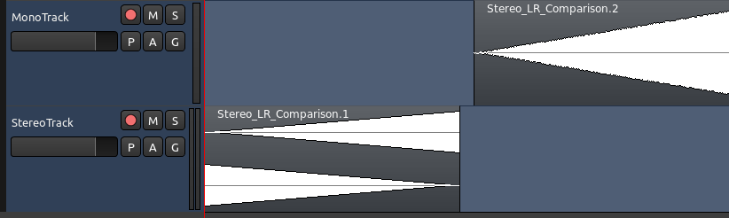
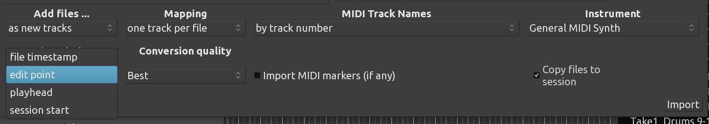

你可以通过将现有的音频和 MIDI 文件作为片段添加到现有或新建的轨道中来重复使用它们。为此，请按 **Ctrl+I** 快捷键，或者前往 `Session > Import Audio/MIDI files` (会话 > Import Audio/MIDI files) 菜单打开 _添加已存在的媒体_ 对话框，选择目标文件并导入它。

有些设置对音频和 MIDI 是通用的，有些则只针对特定格式

## 预览选中的文件

在导入文件之前，最好先确认它是不是你想要的那个文件。在 _添加已存在的媒体_ 对话框的右侧，你会看到一个区域，允许你检查已选文件的属性。在这里，你将看到声音文件的名称、声道数、采样率、格式和长度，以及你选择添加到文件中的任何标签。

**播放**按钮允许你预览文件。如果你希望在文件浏览器中点击某个声音文件时立即听到声音（无需按下 **播放** 按钮），你也可以选择 **自动播放**。

对于 MIDI 文件，你可以选择一个虚拟乐器来播放所选的 MIDI 文件，尽管你无法选择特定的合成器音色。

## 选择轨道和插入点

导入媒体文件有几种常见的场景：将多个音频文件作为新轨道导入并插入到会话开头、将多个音频文件导入到可用源列表以备后用、将单个 MIDI 文件在播放头位置导入到现有轨道中，等等。因此，这里有两个重要的选项：将片段大致插入到哪里（如果要插的话，插在哪条轨道上），以及插入到时间线上的哪个点。

_Add files …_（添加文件…）下拉列表用于选择插入到哪条轨道，而 _Insert at_（插入到）下拉列表用于选择插入到时间线的哪个位置。

## 插入到源列表 (Sources list)

让我们从将一些音频文件导入到源列表的场景开始。

> [!TIP]提示
> 如果你的硬盘上没有合适的音频文件来进行这些步骤，请访问 [freesound.org](http://www.freesound.org/)，在那里你可以找到大量公共领域和知识共享许可的样本，包含各种采样率和格式。

选择一些文件，然后在 _Add files…_（添加文件…）下拉列表中选择 _to source list_（到源列表）。确保 _Mapping_（映射）选项显示为 _每个文件一个音轨_ 。

你会注意到 _Copy files to session_（复制文件到会话）选项默认是勾选的。这会将导入的文件复制到当前会话的文件夹中。这样更安全，但会占用更多磁盘空间。如果你取消勾选此选项（不推荐！），Ardour 将使用硬盘上当前位置的声音文件。在这种情况下，如果文件被移动到了硬盘上的新位置，你就会遇到麻烦，因为下次打开此会话时 Ardour 将无法找到它。**强烈建议你保持勾选此框（_Copy files to session_）**。

点击 **OK** 继续。

你导入的文件将出现在你的 _来源_ 列表中。该列表位于编辑器窗口的最右侧。如果你没有看到它，请确保在 _视图_ 菜单下勾选了 _显示编辑器列表_。

通过将 _来源_ 列表中列出的音频文件拖放到主画布上，你可以将其插入到现有轨道或新轨道中。如果你将其拖入现有轨道，它将被添加到那里。如果你将其拖放到现有轨道下方的空白区域，系统将自动创建一个新轨道来容纳它。

松开鼠标按钮以完成拖放操作。你把它拖放到哪里，新片段就会插入到你选择的时间点哪里。

> [!TIP]提示
> 如果在编辑器列表中选中了一个声音文件（即它被高亮显示为蓝色），下次你点击该文件名时，Ardour 会认为你试图重命名该片段（名称将变为可编辑状态）。而你很可能只是想点击拖动文件到轨道上。为了从列表中点击并拖动一个之前 _高亮_ 的片段，你需要在名称前面或后面的空白处点击。

重要提示：始终确保将立体声片段放置在立体声轨道上。如果你将立体声文件拖到单声道音频轨道上，则只会使用左声道。在下面的截图中，一个左声道和右声道有明显差异的立体声文件被拖到了立体声轨道和单声道轨道上。请注意，在单声道轨道中只显示（并播放）了左声道。

## 直接导入到轨道

如前所述，_添加已存在的媒体_ 对话框还允许你直接将音频文件导入到轨道上。

选择 _Add files… as new tracks_（添加文件…作为新轨道）以自动创建一个新轨道并吧所选文件添加到新轨道。新轨道将以声音文件的名称命名。

如果你之前选择了一个或多个轨道，菜单将显示额外的选项 _Add files… to selected tracks_（添加文件…到选定轨道），以将声音文件添加到已选定的现有轨道中。

请注意，如果你导入一个多轨 MIDI 文件，Ardour 将始终为 MIDI 文件中的每个现有轨道创建一个新轨道，并相应地映射它们。

将文件作为新轨道添加时，请注意 _Mapping_（映射）选项允许你在 _每个声道一个音轨_ 和 _每个文件一个音轨_ 之间进行选择。出于本教程的目的，请选择 _每个文件一个音轨_，否则立体声文件的左右声道将被分成两个单独的轨道。

或者，你可以从文件管理器中将音频和 MIDI 文件拖放到时间线上进行导入。

## 选择插入点

当使用上述任一选项（_Add as new track_ 或 _Add to selected tracks_）时，你还应该指定希望将新片段放置在轨道中的哪个位置。在下面的截图中，我们选择的是 _session start_（会话开头）。

片段出现在会话中的新轨道上。新轨道会自动获取导入声音文件的名称。

该声音文件也会出现在 _区域_ 列表中，以便你可以通过将其拖放到其他轨道中来将其插入到那些轨道中。

## 从轨道中移除片段

要从轨道中移除片段，你可以用鼠标选中它，并使用菜单中的*剪切*功能、**Control**（或 **Apple**）键加 **X** 键、**Delete** 键或组合键 **Fn + Backspace**（例如，用于没有标准 **Delete** 键的笔记本电脑键盘）。

> [!WARNING]警告
> **请经常保存你的项目！** 快捷键 **Control + S** 是你的好伙伴。要记得经常使用它呀。

## 继续

现在你的会话中已经有一些素材了，你可能想要[自定义时间线](/getting-started/setting-up-the-timeline/)以更好地满足你的需求，或者直接跳到[录音](/recording/)部分来录制新的现场素材。