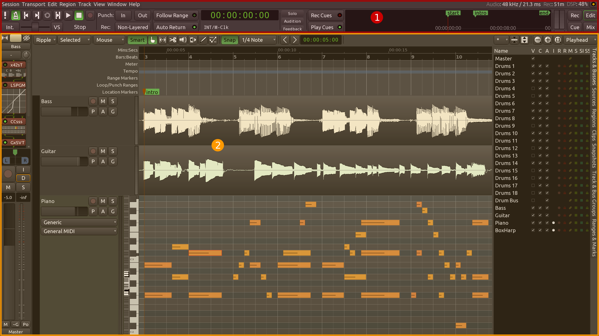

+++
title = "界面概览"
description = "Ardour 用户界面的基础知识"
weight = 2
+++

本节将为您提供 Ardour 用户界面的基本概览。

我们将了解界面的通用元素、主窗口，并重点介绍 _编辑器_ (Editor) 窗口和 _混音器_ (Mixer) 窗口。后续章节将提供此处列出的各项功能的详细信息。

## Ardour 窗口

这是 Ardour 中打开项目的一个典型视图：

用户界面主要包含两个大部分：

1. 静态部分：包含程序菜单、走带控制面板、时钟、导航时间轴以及各种控件。我们将在本页稍后讨论这部分。

2. 动态部分：会根据当前打开的窗口而变化。我们将在后续介绍各个窗口（编辑器）Editor、（混音器）Mixer、（录音器）Recorder、Cue的页面中讨论这部分。

让我们继续了解静态部分，并着重介绍对你当前操作最实用的功能。

## 程序菜单

这是在任何程序中访问功能的一种非常直观的方式，您应该能容易地浏览它。特定于会话的命令在 _会话_ 菜单中，所有与播放和录音相关的功能都在 _播送_ (Transport) 菜单中，大多数编辑功能在 _编辑_ 菜单中，以此类推。

为了方便起见，特定于操作对象的功能在右键菜单中也有选择。例如，您可以在选定 _区域_ 的右键菜单中找到 _区域_ 菜单的内容（片段是您可以在时间轴上看到的剪辑，请参阅教程后面的页面）。

## 信息面板

此面板显示有关当前打开项目的有用信息（采样率、延迟、DSP [数字信号处理] 负载），以及根据当前可用磁盘空间估算出的可录制分钟数。

如果在此处右键单击，您将看到更多选项，例如当前项目快照 (snapshot) 的名称（稍后详细说明）和计时点（如上方截图所示）。

## 播送控制面板
> [!note] Transport汉化说明
> 在 Ardour 9.8 及后续版本中，官方中文界面将 **Transport** 翻译为 **“播送”**。为了让你能在软件中准确找到对应按钮，本手册统一采用此译名
> 
> 注：在中文音频社区中，该功能更常被称为“走带”（如“走带控制面板”），两者指代的是同一功能

面板底部配有慢进/飞梭 (jog/shuttle) 控件，用于在回放会话内容时，以不同的速度向前或向后移动/穿梭。

如果您想要让不带慢进/飞梭控件的走带控制面板出现在屏幕的其他位置，可以打开一个名为_走带控制_ (Transport Controls) 的浮动窗口（`窗口 > 走带控制`）。您可以将此窗口移动到屏幕上的任何位置，并调整其大小。

## 时钟

主 _时钟_ 位于走带控制旁边。Ardour 中的时钟可以以 4 种不同的格式显示时间：时间码 (Time Code)、小节:拍 (Bars:Beats)、分钟:秒 (Minutes:Seconds) 和样本 (Samples)。右键单击时钟以选择格式。您也可以关闭时钟。设置两个走带时钟的原因是，它允许您无需更改任何设置即可用两种不同的时间单位查看播放头 (playhead) 的位置。

如果您在家庭工作室工作，使用脚踏开关来切换录音，并且离屏幕有几米远，您可能需要一个更大的时钟。使用 `窗口 > 大计时器`打开一个浮动在所有其他窗口之上的时钟窗口，并根据您的喜好调整其大小。

有关时钟的更多详细信息，请参阅[设置时间轴](../setting-up-the-timeline)章节。

## 导航时间轴

在这两个时钟的右侧，您可以看到 _微型时间轴_ (mini-timeline)，也称为 _时间线导航_ (Navigation Timeline)。它是一种非常方便的方式来提醒您提示点 (cues) 和位置标记 (location markers)，特别是当您在 _录音器_ (Recorder) 窗口中时，因为那里的时间轴没有这些标尺。

请查阅 Ardour 手册以获取有关[微型时间轴](https://manual.ardour.org/ardours-interface/mini-timeline/)的更多信息。

## 切换窗口

在全局工具栏的右侧，紧挨着 _导航时间轴_ 和主总线输出电平表之后，您会发现一个方便的控件，用于在 Ardour 的主要窗口之间切换——编辑器、混音器、录音器和 Cue。

或者，您可以使用 **Ctrl+PageUp/PageDown** 快捷键循环切换窗口，就像在任何 Web 浏览器中一样。

您也可以使用 **Alt+M** 快捷键在 _编辑器_ 和 _混音器_ 窗口之间切换。如果您当前位于 _录音器_ 或 _Cue_ 窗口中，第一次按下该快捷键将带您进入 _混音器_ 窗口，再按一次将带您进入 _编辑器_ 窗口。

**下一步**

接下来的章节将解释 Ardour 主要窗口的基础知识：


  
  
  
  
