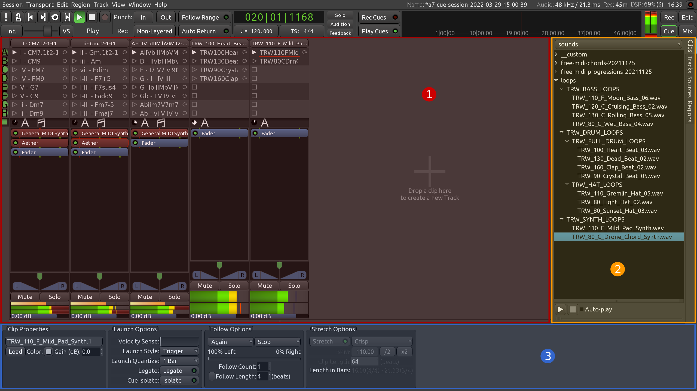
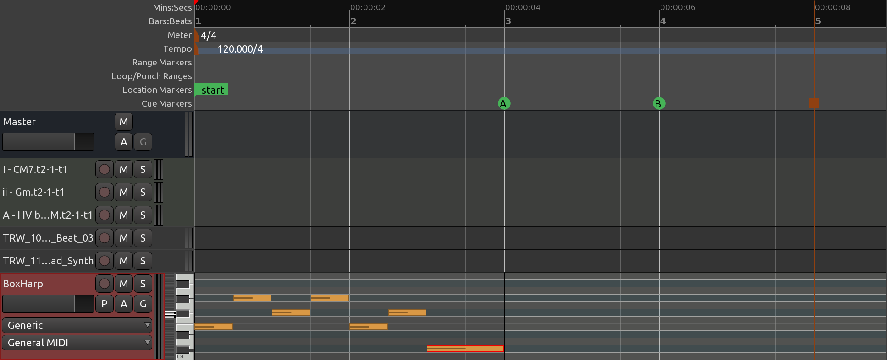

_Cue_ 窗口提供了使用 Ardour 设置现场表演的工具。本教程中我们不会使用 _Cue_，所以这里只是一个快速概览，让您对这些内容有一个基本的了解。

## 用户界面元素

该界面的设计风格与其他同类软件保持一致，符合用户的使用习惯

以下是主要的 UI 部分：

1. 片段启动器网格 (Clip launchers grid)
2. 片段设置面板 (Clip settings panel)
3. 可复用片段浏览器 (Reusable clips browser)

从左到右是包含片段的轨道（当您切换到 _编辑器_ 窗口时，这些轨道在时间轴上不可见）。从上到下是 8 行，称为场景 (scenes)，从 _A_ 到 _P_。

右侧的浏览器允许您轻松地将预录制的片段拖放到片段槽中进行播放。您可以使用音频和 MIDI 片段。将片段拖放到空白处将创建一个新轨道，并自动使用该片段填充第一个槽位（场景 _A_）。

下方的设置允许您自定义片段的播放方式，例如是否将其拉伸以匹配特定的 bpm 值，是否触发播放某个特定的其他片段等。

## 非线性工作流

使用片段启动器通常被称为非线性工作流，因为它基于预录制片段的循环播放，您不必直接按顺序从场景 A 走到场景 H。

您可以这样设置片段启动器：场景 _B_ 中的片段将播放 4 次，触发场景 _A_ 中的片段播放 2 次，然后跳转到片段 _C_ 并播放 6 次，然后再回到片段 _B_，就这样一遍又一遍地重复整个循环，直到您手动停止它。而且所有这些操作都无需按下走带控制上的 **播放 (Play)** 按钮来从头到尾播放一首歌。

## 线性和非线性工作流结合

虽然您可以一直在 _Cue_ 窗口中现场播放整首歌曲——特别是当您拥有硬件网格控制器和所有可能需要的预录制片段时——您也可以将片段启动器集成到 _编辑器_ 窗口的常规线性工作流中。要做到这一点，您需要在 _Cue 标记 (Cue Markers)_ 时间轴中添加标记。

下面是一个简单的例子：

Ardour 会先播放使用采样乐器的常规 MIDI 轨道的两个小节，然后在第 3 小节启动场景 _A_，在第 4 小节启动场景 _B_，并在第 5 小节停止所有场景。您可以在原本的线性项目中的任何时间触发和停止场景，想重复几次就重复几次。

**继续**

既然您已经熟悉了 Ardour 的主要窗口，让我们跳到下一节，我们将创建一个新轨道，然后导入一些音频文件。