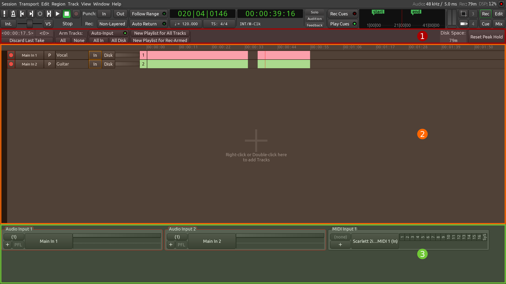
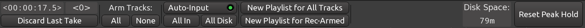
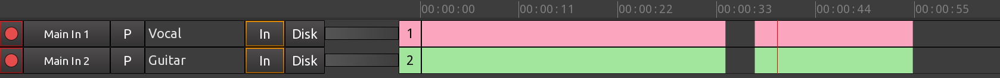
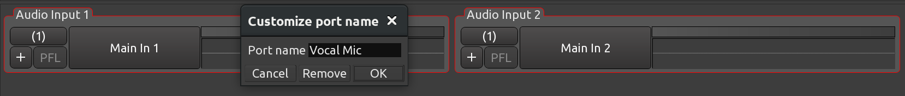
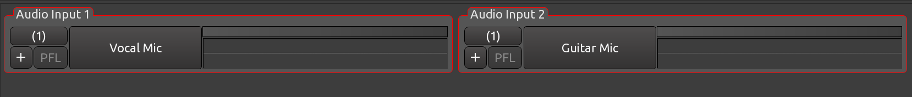

_录音机_ (Recorder) 窗口针对一种特定的使用场景进行了专门优化：多轨录音。为了排除一切干扰，界面经过了刻意简化

如上图所示，录音机窗口包含三个主要区域：

1. 窗口工具栏
2. 时间轴与轨道视图
3. 输入控制

## 窗口工具栏

工具栏中包含特定的命令和信息：启用/停用所有轨道的录音准备 (Arm)、丢弃最后一次录音 (Take)、自动切换所有输入以进行信号监听、预估磁盘剩余空间可支持的录制时长等

## 时间轴与轨道视图

时间轴仅显示时间码，并且轨道视图中完全不渲染波形。这在同时录制数十条轨道时，可以节省系统资源。

## 输入控制

窗口的底部是输入控制区：您可以在此监听输入音量，或者为了方便操作而重命名物理端口。若要重命名，只需点击输入端口名称并输入新名称即可。

例如，如果您有两个麦克风输入，一个用于人声，一个用于吉他，给它们起个相应的名字，可以轻松地在轨道上输入新名字。对于拥有 18 个通道等大型音频接口来说优势很明显。

如果您使用了 [I/O 插件](https://manual.ardour.org/recording/io-plugins/)，这些插件的输入也会显示在轨道输入旁边。

**接下来**

在本章最后一节中，我们将快速了解 _Cue_ 窗口，它提供了一种大家熟悉的界面，用于触发音频和 MIDI 片段 (Clips)。